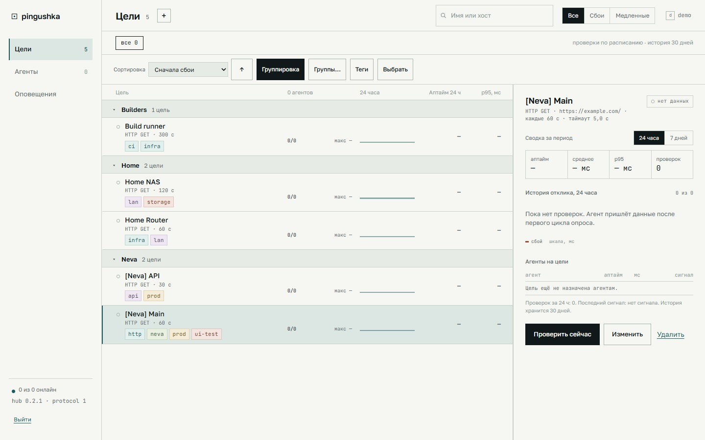
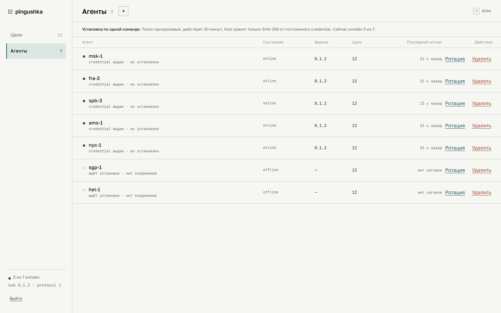
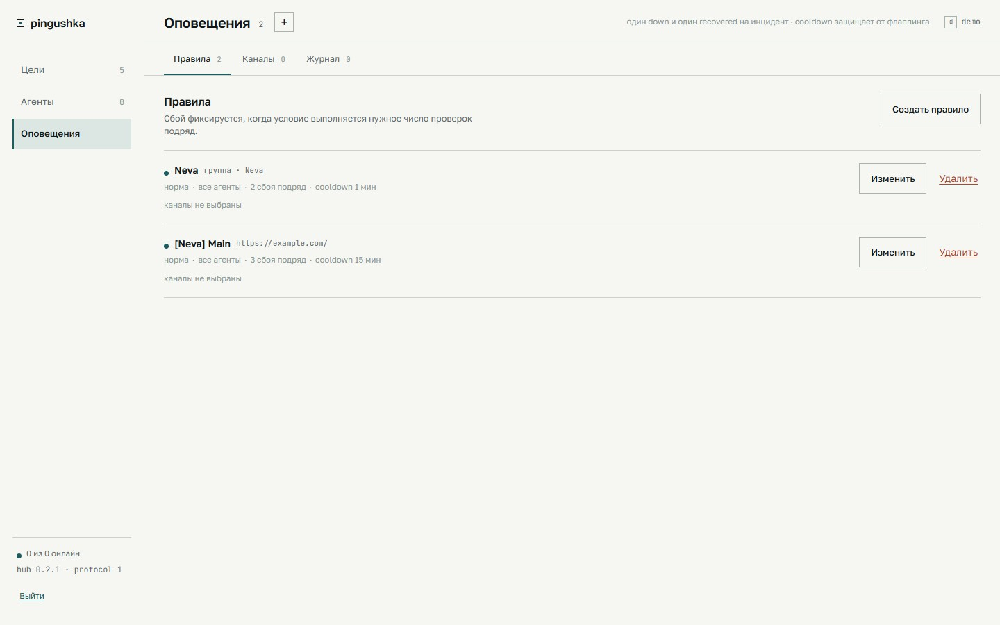
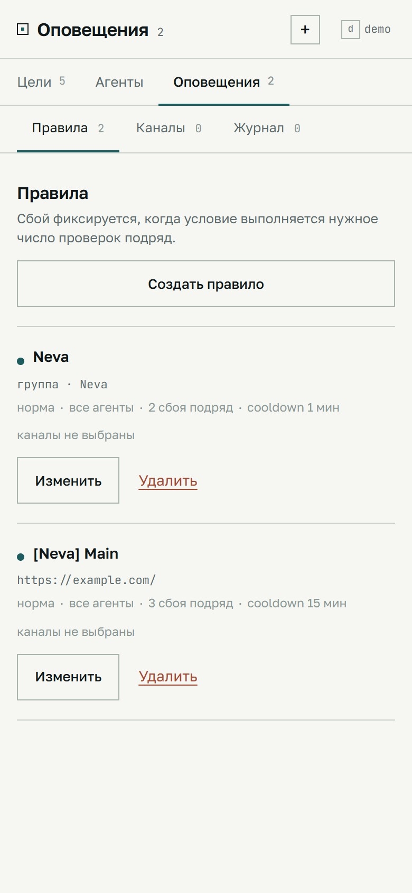

# Pingushka

[English](README.md) | [Русский](README.ru.md)

**Distributed uptime monitoring with a central Hub and lightweight Linux probes.**

Pingushka runs HTTP(S), TCP-port and ICMP checks from agents in different networks, stores the history in PostgreSQL, and shows availability, latency and per-agent results in a web dashboard.

[](https://github.com/vasilchenkome/pingushka/actions/workflows/ci.yml)
[](https://github.com/vasilchenkome/pingushka/releases/latest)
[](LICENSE)



## Status

**v0.2.1 — target groups and tags.** The Hub, PostgreSQL storage, authenticated REST API, WebSocket protocol, Linux agent, SPA dashboard, Docker image, releases and the `install.sh` installer are implemented and used in a live deployment. Targets can now be organised into groups, tagged, sorted, filtered and edited in bulk; alert rules work per target or per group.

The dashboard UI is currently in Russian.

## Features

- **HTTP(S)** — `GET` or `HEAD`, expected status code, explicit timeout, redirect limit.
- **TCP** — connect to a host and port.
- **ICMP** — ping with an explicit `tcp_fallback` mode when raw sockets are unavailable.
- **Distributed probes** — one target can be assigned to any number of agents; each agent checks from its own network.
- **History and summaries** — 24-hour and 7-day uptime, average latency, p95 and check counts.
- **Offline buffering** — agents keep results in a bounded JSONL buffer and drain it after reconnecting.
- **Agent auto-update** — a daily systemd timer downloads the latest stable release, verifies its SHA-256 and rolls back if the service fails to restart.
- **One-time enrollment** — a 256-bit token is exchanged for a permanent credential; the Hub stores only its SHA-256 hash.
- **Authentication** — first-run administrator setup, Argon2id passwords, HttpOnly session cookies, login rate limiting.
- **Docker and HTTPS** — the Hub image serves the SPA itself; Docker Compose includes PostgreSQL and Caddy with automatic TLS.
- **Multi-arch images** — `linux/amd64` and `linux/arm64`, built on native GitHub runners.
- **Alerts** — Telegram, generic webhooks and SMTP email. Rules use a failure threshold, a recovery threshold and a cooldown; each incident produces exactly one `down` and one `recovered` message.
- **Delivery journal** — encrypted channel secrets, an outbox with retries and a per-event status visible in the dashboard.
- **Groups and tags** — a flat group tree, up to 10 tags per target, a group manager, tag filters, sorting, collapsible groups and bulk group/tag edits. Groups and tags never change probe behaviour or reach agents.
- **Group alert rules** — a rule can cover a whole group; it acts as the default for targets without their own rule and raises a separate group incident.

## Screenshots

| Targets | Agents |
| --- | --- |
|  |  |

| Alerts | Alerts on a phone |
| --- | --- |
|  |  |

## Quick start

Requirements: Docker with Compose v2.

```sh
git clone https://github.com/vasilchenkome/pingushka.git
cd pingushka
cp .env.example .env
```

Set a strong `POSTGRES_PASSWORD` in `.env`, generate `ALERT_SECRET_KEY` with `openssl rand -hex 32`, keep `PUBLIC_URL=http://127.0.0.1:8080`, `COOKIE_SECURE=false` and choose a release, for example `PINGUSHKA_VERSION=0.2.1`.

```sh
docker compose pull postgres hub
docker compose up -d --no-build postgres hub
```

Open <http://127.0.0.1:8080> and create the first administrator. The Hub serves the SPA and `/api` from the same origin.

## Add an agent

Create an agent in **Agents** and run the generated command on a Linux host. Each agent has its own one-time token:

```sh
curl -fsSL https://raw.githubusercontent.com/vasilchenkome/pingushka/main/install.sh \
  | sudo sh -s -- --hub https://monitor.example.com --enrollment-token <token> --version v0.2.1
```

The installer:

- downloads the release binary for x86_64 or ARM64 and verifies its SHA-256 checksum;
- exchanges the enrollment token for a permanent credential;
- writes `/etc/pingushka/agent.toml` with mode `0600`;
- installs and starts `pingushka-agent.service`;
- grants `CAP_NET_RAW` for ICMP and enables the ping group range.

Results are buffered in `/var/lib/pingushka/buffer.jsonl`. Logs: `journalctl -u pingushka-agent -f`.

The installer also enables a daily `pingushka-agent-update.timer`. It checks the latest stable release with a randomized delay, verifies the checksum and replaces the binary atomically. If the service does not come back, the previous binary is restored. Disable it with `--no-auto-update`; logs: `journalctl -u pingushka-agent-update -f`.

Use `--version v0.2.1` to pin a release; omit it to install the latest one.

### Uninstall an agent

```sh
sudo systemctl disable --now pingushka-agent.service
sudo systemctl disable --now pingushka-agent-update.timer
sudo rm -f /etc/systemd/system/pingushka-agent.service
sudo rm -f /etc/systemd/system/pingushka-agent-update.service
sudo rm -f /etc/systemd/system/pingushka-agent-update.timer
sudo systemctl daemon-reload
sudo rm -f /usr/local/bin/pingushka-agent /usr/local/bin/pingushka-agent.previous
sudo rm -rf /etc/pingushka /var/lib/pingushka /usr/local/lib/pingushka
sudo rm -f /etc/sysctl.d/99-pingushka.conf
sudo userdel pingushka
```

Then delete the agent in the dashboard to revoke its credential.

## Alerts

Open **Alerts** in the dashboard, add a channel and then attach a rule to a target.

- **Telegram** — bot token and chat ID. The Hub calls `sendMessage`.
- **Webhook** — an HTTP(S) endpoint. The JSON body is the event payload; when a secret is set, the request carries `X-Pingushka-Signature: sha256=<hex HMAC-SHA256>`.
- **Email** — SMTP host, port, From/To and optional credentials; STARTTLS (587), implicit TLS (465) or plain SMTP for local Mailpit.

A rule uses `all` (every fresh agent sees a failure) or `any`; offline agents are ignored. A `down` event is created after `failure_threshold` consecutive failed evaluations; `recovered` is created after `recovery_threshold` successful ones. Each incident sends one `down` and one `recovered`; a new failure during `cooldown_secs` waits as `pending` instead of sending a duplicate. Channel secrets are encrypted and never returned by the API.

## Public deployment

Point a DNS `A`/`AAAA` record at the host and set the domain in `.env`:

```dotenv
POSTGRES_PASSWORD=<long-random-password>
ALERT_SECRET_KEY=<openssl rand -hex 32>
PUBLIC_URL=https://monitor.example.com
COOKIE_SECURE=true
DOMAIN=monitor.example.com
PINGUSHKA_VERSION=0.2.1
```

```sh
docker compose pull
docker compose up -d --no-build
```

Caddy obtains a Let's Encrypt certificate, redirects HTTP to HTTPS and proxies to `hub:8080`. Only ports 80 and 443 are exposed; PostgreSQL and the Hub stay on the internal network.

## Architecture

| Crate | Responsibility |
| --- | --- |
| `domain` | Entities and invariants: targets, checks, users, agents, enrollments. No I/O. |
| `application` | Use cases, ports and query models. |
| `protocol` | Versioned WebSocket DTOs (`PROTOCOL_VERSION = 1`). |
| `storage-postgres` | Migrations, repositories, batch insert and summary queries. |
| `hub-http` | REST API, sessions, WebSocket endpoint, static SPA serving. |
| `hub-bin` | Hub composition root and configuration. |
| `agent-bin` | Scheduler, probes, result buffer, WebSocket client, systemd entry point. |
| `frontend` | React + Vite + TypeScript dashboard. |

Agents connect outbound to the Hub over WebSocket, so they work behind NAT. Configuration and commands travel down; check results travel up. Results are written in short transactions with `ON CONFLICT DO NOTHING`; expired history is pruned in the background.

## Security model

Security reports: see [SECURITY.md](SECURITY.md). Do not open a public issue for a vulnerability.

- The first browser visit creates a single local administrator; there is no public signup.
- Passwords are hashed with Argon2id. Sessions use HttpOnly cookies (`SameSite=Lax`, `Secure` behind HTTPS) and login attempts are rate-limited.
- Enrollment tokens are one-time, valid for 30 minutes and stored hashed on the Hub.
- Agent credentials are stored only on the agent, in a `0600` configuration file.
- Rotating an agent credential closes its current WebSocket session.
- The Hub is not published directly: Caddy terminates TLS and proxies to it.
- Alert channel secrets are encrypted with XChaCha20-Poly1305 using `ALERT_SECRET_KEY`; the API never returns them after saving.
- CI ignores RUSTSEC-2026-0459 for `libsqlite3-sys`: it is pulled in by sqlx's optional SQLite dependency, which is not enabled; Pingushka uses PostgreSQL only.

## Configuration

The Hub reads these environment variables:

| Variable | Default | Purpose |
| --- | --- | --- |
| `DATABASE_URL` | — | PostgreSQL connection string. |
| `BIND_ADDR` | `0.0.0.0:8080` | HTTP listen address. |
| `PUBLIC_URL` | `http://localhost:8080` | Public origin used in generated commands. |
| `COOKIE_SECURE` | `false` | Set `true` behind HTTPS. |
| `SESSION_TTL_HOURS` | `168` | Session lifetime. |
| `ENROLLMENT_TTL_MINUTES` | `30` | Enrollment token lifetime. |
| `RETENTION_DAYS` | `30` | Check history retention. |
| `MANUAL_CHECK_COOLDOWN_SECS` | `30` | Cooldown for manual checks. |
| `PRUNE_INTERVAL_MINUTES` | `60` | Background pruning interval. |
| `STATIC_DIR` | — | Directory with the built SPA. The image sets `/app/static`. |
| `INSTALL_SCRIPT_URL` | GitHub raw URL | Installer URL shown with generated agent commands. |
| `ALERT_SECRET_KEY` | — | 32-byte hex or base64 key for encrypting alert channel secrets. Required. Keep it stable; changing it makes saved channel secrets unreadable. |
| `ALERT_EVALUATE_INTERVAL_SECS` | `30` | How often alert rules are evaluated. |
| `TELEGRAM_API_BASE` | `https://api.telegram.org` | Telegram Bot API base; override only for a local mock. |

Docker Compose also reads `POSTGRES_USER`, `POSTGRES_PASSWORD`, `POSTGRES_DB`, `DOMAIN` and `PINGUSHKA_VERSION`.

## Development

Requirements: stable Rust toolchain, Node 22 or newer, Docker.

```sh
cp .env.example .env
docker compose up -d postgres

cargo build --workspace
cargo test --workspace
cargo clippy --workspace --all-targets --all-features -- -D warnings
sh -n install.sh
bash packaging/tests/update-agent.sh

cd frontend
npm install
npm run dev
```

Vite serves <http://127.0.0.1:5173> and proxies `/api` to `127.0.0.1:8080`. `npm run build` writes the production bundle to `frontend/dist`; the Hub serves it from `STATIC_DIR`.

The local PostgreSQL port is bound to `127.0.0.1`. `.env` is ignored by Git. `docker compose down -v` removes the local database volume.

## Releases and images

- Hub image: `ghcr.io/vasilchenkome/pingushka-hub:0.2.1` (also `0.2`, `latest`, `main`, `sha-*`), multi-arch.
- Agent image: `ghcr.io/vasilchenkome/pingushka-agent:0.2.1`, multi-arch, for container-based probes.
- Release binaries: <https://github.com/vasilchenkome/pingushka/releases>.
- The `Image` workflow publishes on pushes to `main` and on `v*` tags.
- The `Release` workflow builds the Hub and agent binaries with `SHA256SUMS` for `install.sh`.

## Limitations and roadmap

- Agents support Linux x86_64 and ARM64 only.
- Alert channels are Telegram, generic webhooks and SMTP email; SMS, PagerDuty and Opsgenie are not built in.
- The auto-updater restarts `pingushka-agent.service` only; additional agent units on the same host must be restarted manually.
- One administrator, no roles or SSO.
- The dashboard UI is Russian-only.

Planned next: more channel integrations and high-availability guidance.

## License

MIT. See [LICENSE](LICENSE).
