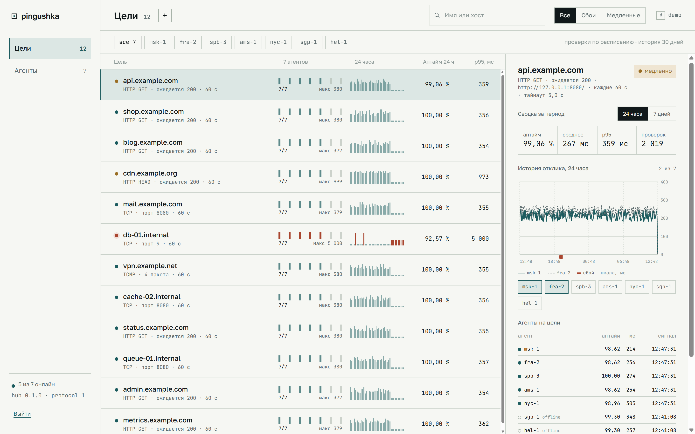
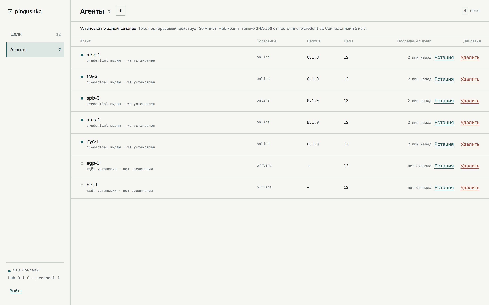
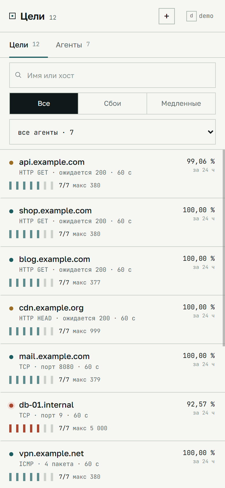

# Pingushka

[English](README.md) | [Русский](README.ru.md)

**Распределённый мониторинг доступности: центральный Hub и лёгкие Linux-агенты.**

Pingushka выполняет проверки HTTP(S), TCP-портов и ICMP с агентов в разных сетях, хранит историю в PostgreSQL и показывает доступность, задержки и результаты по каждому агенту в веб-дашборде.

[](https://github.com/vasilchenkome/pingushka/actions/workflows/ci.yml)
[](https://github.com/vasilchenkome/pingushka/releases/latest)
[](LICENSE)



## Статус

**v0.1.1 — MVP выпущен.** Hub, хранилище PostgreSQL, REST API с авторизацией, WebSocket-протокол, Linux-агент, SPA-дашборд, Docker-образ, релизы и установщик `install.sh` реализованы и используются в живом развёртывании.

Интерфейс дашборда пока на русском.

## Возможности

- **HTTP(S)** — `GET` или `HEAD`, ожидаемый код ответа, явный таймаут, ограничение редиректов.
- **TCP** — подключение к хосту и порту.
- **ICMP** — ping с явным режимом `tcp_fallback`, если raw-сокеты недоступны.
- **Распределённые пробы** — цель можно назначить любому числу агентов; каждый проверяет её из своей сети.
- **История и сводка** — аптайм, средняя задержка, p95 и число проверок за 24 часа и 7 дней.
- **Буфер при обрыве** — агент хранит результаты в ограниченном JSONL-буфере и отправляет их после переподключения.
- **Одноразовая регистрация** — 256-битный токен обменивается на постоянный credential; Hub хранит только его SHA-256.
- **Авторизация** — создание администратора при первом запуске, Argon2id, HttpOnly-сессии, ограничение попыток входа.
- **Docker и HTTPS** — образ Hub сам раздаёт SPA; Docker Compose включает PostgreSQL и Caddy с автоматическим TLS.
- **Multi-arch образы** — `linux/amd64` и `linux/arm64`, сборка на нативных раннерах GitHub.

## Скриншоты

| Агенты | Телефон |
| --- | --- |
|  |  |

## Быстрый старт

Нужен Docker с Compose v2.

```sh
git clone https://github.com/vasilchenkome/pingushka.git
cd pingushka
cp .env.example .env
```

Задайте надёжный `POSTGRES_PASSWORD` в `.env`, оставьте `PUBLIC_URL=http://127.0.0.1:8080`, `COOKIE_SECURE=false` и выберите релиз, например `PINGUSHKA_VERSION=0.1.1`.

```sh
docker compose pull postgres hub
docker compose up -d --no-build postgres hub
```

Откройте <http://127.0.0.1:8080> и создайте первого администратора. Hub раздаёт SPA и `/api` с одного origin.

## Установка агента

Создайте агента в разделе **Агенты** и выполните сгенерированную команду на Linux-хосте. У каждого агента свой одноразовый токен:

```sh
curl -fsSL https://raw.githubusercontent.com/vasilchenkome/pingushka/main/install.sh \
  | sudo sh -s -- --hub https://monitor.example.com --enrollment-token <токен> --version v0.1.1
```

Установщик:

- скачивает релизный бинарь для x86_64 или ARM64 и проверяет SHA-256;
- обменивает enrollment-токен на постоянный credential;
- пишет `/etc/pingushka/agent.toml` с правами `0600`;
- ставит и запускает `pingushka-agent.service`;
- выдаёт `CAP_NET_RAW` для ICMP и включает ping group range.

Буфер результатов хранится в `/var/lib/pingushka/buffer.jsonl`. Логи: `journalctl -u pingushka-agent -f`.

`--version v0.1.1` фиксирует релиз; без него ставится последний.

### Удаление агента

```sh
sudo systemctl disable --now pingushka-agent.service
sudo rm -f /etc/systemd/system/pingushka-agent.service
sudo systemctl daemon-reload
sudo rm -f /usr/local/bin/pingushka-agent
sudo rm -rf /etc/pingushka /var/lib/pingushka
sudo rm -f /etc/sysctl.d/99-pingushka.conf
sudo userdel pingushka
```

После этого удалите агента в дашборде, чтобы отозвать credential.

## Публичное развёртывание

Направьте `A`/`AAAA`-запись домена на сервер и укажите домен в `.env`:

```dotenv
POSTGRES_PASSWORD=<длинный-случайный-пароль>
PUBLIC_URL=https://monitor.example.com
COOKIE_SECURE=true
DOMAIN=monitor.example.com
PINGUSHKA_VERSION=0.1.1
```

```sh
docker compose pull
docker compose up -d --no-build
```

Caddy получает сертификат Let's Encrypt, перенаправляет HTTP на HTTPS и проксирует на `hub:8080`. Наружу открыты только 80 и 443; PostgreSQL и Hub остаются во внутренней сети.

## Архитектура

| Крейт | Ответственность |
| --- | --- |
| `domain` | Сущности и инварианты: цели, проверки, пользователи, агенты, регистрации. Без I/O. |
| `application` | Сценарии, порты и модели запросов. |
| `protocol` | Версионированные WebSocket-DTO (`PROTOCOL_VERSION = 1`). |
| `storage-postgres` | Миграции, репозитории, батч-вставка и запросы сводки. |
| `hub-http` | REST API, сессии, WebSocket, раздача статического SPA. |
| `hub-bin` | Точка сборки Hub и конфигурация. |
| `agent-bin` | Планировщик, пробы, буфер результатов, WebSocket-клиент, вход для systemd. |
| `frontend` | Дашборд на React + Vite + TypeScript. |

Агенты подключаются к Hub исходящим WebSocket-соединением, поэтому работают за NAT. Конфигурация и команды идут вниз, результаты проверок — вверх. Результаты пишутся короткими транзакциями с `ON CONFLICT DO NOTHING`; устаревшая история удаляется фоновым pruner.

## Модель безопасности

- Первый визит в браузере создаёт одного локального администратора; публичной регистрации нет.
- Пароли хэшируются Argon2id. Сессии — HttpOnly-cookie (`SameSite=Lax`, `Secure` за HTTPS), попытки входа ограничены.
- Enrollment-токены одноразовые, действуют 30 минут и хранятся на Hub в виде хэша.
- Credential агента хранится только у агента, в конфиге с правами `0600`.
- Ротация credential закрывает текущую WebSocket-сессию агента.
- Hub не публикуется напрямую: TLS терминирует Caddy.

## Конфигурация

Hub читает переменные окружения:

| Переменная | По умолчанию | Назначение |
| --- | --- | --- |
| `DATABASE_URL` | — | Строка подключения к PostgreSQL. |
| `BIND_ADDR` | `0.0.0.0:8080` | Адрес HTTP-сервера. |
| `PUBLIC_URL` | `http://localhost:8080` | Публичный origin для генерируемых команд. |
| `COOKIE_SECURE` | `false` | Включить `true` за HTTPS. |
| `SESSION_TTL_HOURS` | `168` | Время жизни сессии. |
| `ENROLLMENT_TTL_MINUTES` | `30` | Время жизни enrollment-токена. |
| `RETENTION_DAYS` | `30` | Хранение истории проверок. |
| `MANUAL_CHECK_COOLDOWN_SECS` | `30` | Пауза между ручными проверками. |
| `PRUNE_INTERVAL_MINUTES` | `60` | Интервал фоновой очистки. |
| `STATIC_DIR` | — | Каталог собранного SPA. В образе — `/app/static`. |
| `INSTALL_SCRIPT_URL` | GitHub raw URL | Ссылка на установщик в командах агента. |

Docker Compose также читает `POSTGRES_USER`, `POSTGRES_PASSWORD`, `POSTGRES_DB`, `DOMAIN` и `PINGUSHKA_VERSION`.

## Локальная разработка

Нужны stable Rust toolchain, Node 22 или новее и Docker.

```sh
cp .env.example .env
docker compose up -d postgres

cargo build --workspace
cargo test --workspace
cargo clippy --workspace --all-targets --all-features -- -D warnings

cd frontend
npm install
npm run dev
```

Vite отдаёт <http://127.0.0.1:5173> и проксирует `/api` на `127.0.0.1:8080`. `npm run build` собирает продакшен-бандл в `frontend/dist`; Hub раздаёт его из `STATIC_DIR`.

Порт локальной PostgreSQL привязан к `127.0.0.1`. `.env` исключён из Git. `docker compose down -v` удаляет локальный том базы.

## Релизы и образы

- Образ Hub: `ghcr.io/vasilchenkome/pingushka-hub:0.1.1` (также `0.1`, `latest`, `main`, `sha-*`), multi-arch.
- Релизные бинари: <https://github.com/vasilchenkome/pingushka/releases>.
- Workflow `Image` публикует образы при пуше в `main` и по тегам `v*`.
- Workflow `Release` собирает Hub и агентов с `SHA256SUMS` для `install.sh`.

## Ограничения и планы

- Агенты только для Linux x86_64 и ARM64.
- Оповещений пока нет: дашборд показывает состояние и историю, но не отправляет уведомления.
- Один администратор, без ролей и SSO.
- Интерфейс дашборда только на русском.

Дальше по плану: уведомления в Telegram и webhook с порогом сбоев и сообщением о восстановлении.

## Лицензия

MIT. См. [LICENSE](LICENSE).
